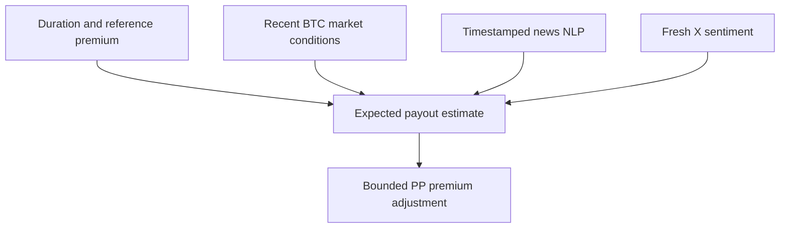

# Jasper Vault PP pricing: a combined market, news and social sentiment experiment

**DBA5102 — Option 2: Options Pricing Model | Main assignment framework: V3.2**

Our project investigates whether a bounded adjustment to an existing PP premium can improve the balance between expected payouts, customer willingness to buy and gross margin. The proposed framework combines duration, BTC market conditions, news NLP and X/Twitter sentiment. **The combined framework is our assignment experiment**, with component comparisons showing what each information layer contributes.

The framework generates reproducible prices, reacts to new information and limits price adjustments. A July retrospective scenario gives encouraging gross-margin results relative to recorded premiums. The newly released validation data contains no payouts, so its accuracy and profitability await Jasper's scoring. Including the combined framework in the submission is an experimental design choice, not proof of superiority.

## 1. Problem and proposed solution

PP is short-duration protection: customers pay premiums and Jasper pays eligible claims. Raising every price is insufficient because customers may stop buying. We follow the assignment's dynamic-adjustment approach:

**Experimental premium = compatible reference premium × bounded pricing multiplier.**

A duration-based estimate of the claim-to-premium ratio is adjusted for market conditions, recent headlines and fresh social sentiment. The resulting risk score can increase or decrease a price. Missing information produces an explicit fallback.



The existing components are calibrated to a **recorded-premium-compatible PP quote**, not automatically the raw API 0DTE price. The new export permits conditional reconstruction using `quantity_BTC × (apiBasePrice_per_BTC_USDC + markup_per_BTC_USDC)` on some rows. Jasper must confirm that mapping before applying these recommendations to its official base price. Missing markup is never treated as zero.

## 2. Data and approach

| Input | Scope and treatment |
|---|---|
| Training | Original February–July 2026 PP data; this release uses outcomes only for historical scoring |
| Frozen model | July-1 coefficients and text vocabulary; no refitting on new months or validation |
| Validation | 4,155 orders, 31 July–14 October 2026; actual payouts and recorded premiums withheld |
| Market | Supplied completed one-minute BTC candles, ending 24 August 2026 at 08:36:59.999 UTC |
| News | **153 records**, including **65 added headlines**: 37 in August, 21 in September, 7 in October |
| Social | **351 BTC snapshots**, including **103 added observations from 11 weekly files**, August 2–October 11; 322 survive the methodology cutoff |

Headlines cover markets, macro conditions, regulation, security and infrastructure. The latest included headline is October 12; this is a dated research sample, not complete daily news coverage. Only short headlines, URLs and clocks are distributed. Social snapshots are aggregates, not 351 unique tweets. Added raw weekly files contain 24,180 observations across assets; the model uses BTC social fields only.

We inspected the assignment, partner brief, class notes and dictionary; audited input definitions; preserved the existing model; collected external inputs; built past-only joins; and compared components on identical rows. A coverage audit prompted an additional weekend search because social samples concentrated on Sundays. This is documented in [PROTOCOL.md](revision_v3_2/PROTOCOL.md); no coefficients or thresholds were tuned to the resulting validation outputs.

## 3. Findings against the six assignment requirements

### A. Improve profitability

For 2,625 eligible July orders, the combined framework produces **4,713.57 USDC** of modelled gross margin under the pre-specified elasticity-4 scenario, versus **4,042.04 USDC** at recorded premiums: **+671.53 USDC (+16.61%)**. Assumed mean retention is **97.95%**. The worst creation-day margin is **−4,798.38 USDC**; a positive aggregate does not establish stable daily returns or controlled tail losses.

The scenario calculates `sum(min(1, multiplier^-elasticity) × (experimental premium − historical payout))`. It does not observe customers' reactions to new prices or include all hedging, fees and capital costs. July was already examined in earlier project iterations. These figures are retrospective scenario evidence, not a causal profit gain over Jasper's internal base model. Validation profitability remains unscored.

### B. Identify meaningful pricing factors

The framework examines duration, short/long-window volatility, recent momentum, time of day, weekends, option direction, news intensity, headline text and sentiment. Duration ratios use partial pooling. News uses **TF-IDF with three SVD components** and event indicators. Our adjustment models are **regularized log-link quasi-Poisson regressions with a fixed expected-payout offset**. The social provider supplies precomputed hybrid NLP sentiment; we do not train its transformers.

**814 validation multipliers change when the additional collection is introduced.** This establishes responsiveness, not predictive significance. [Learned coefficients](revision_v3_2/results/learned_factors.csv) and component comparisons make the effects inspectable. The sentiment extension tests incremental information; it does not establish that narrative tone causes claims.

### C. Account for market conditions and moneyness

Volatility, momentum, time and direction allow risk to vary across market states. Only completed candles and information available before each quote enter the features. Historical headline availability uses the later displayed publication/update clock plus five minutes. Social availability uses a conservative session-end proxy and a four-hour maximum age from session admission.

**Class notes specify ATM-only contracts, with 0% deductible and 100% coverage.** We do not manufacture an ATM/OTM comparison from differences between strike prices and external exchange candles. OTM development requires verified underlying prices and contracts spanning strike distances; it is not validated here.

### D. Maintain commercially reasonable pricing

The multiplier is bounded between **0.987094 and 1.012906**, approximately **±1.29%** around the compatible reference. Under the assumed elasticity-4 response this implies at least 95% retention per quote; it is not an observed customer guarantee.

On the **same 474 validation rows** with market coverage and conditionally reconstructed references:

| Component comparison, same July-1 calibration | Total quoted premiums, USDC | Change versus reference |
|---|---:|---:|
| Reconstructed reference | 31,903.79 | — |
| Duration component | 32,110.74 | +0.649% |
| Market + news | 31,997.24 | +0.293% |
| Market + news + social activity | 31,996.13 | +0.289% |
| **Combined framework with sentiment** | **31,996.58** | **+0.291%** |

The combined framework discounts **44.09%** of this subset. Assumed mean retention is **98.22%**. These are quoted prices, not earned revenue or realised profit. Small differences between social variants do not establish an economically meaningful improvement.

### E. Perform well on unseen data

The frozen model produces **4,148 relative factors**, preserving all 4,155 original row positions, with **7 abstentions** for nominal-duration/timestamp inconsistencies. **1,893 rows** have market inputs for the expanded model. Fresh social matches **447 quotes**, and the social layer can be applied to **374**. **209 quotes** have both a sampled four-hour headline and fresh social data. **2,255 rows** use the duration component because market data is absent or stale.

| Validation month | Orders | Fresh market | News within 4 hours | Fresh social | Social layer applied |
|---|---:|---:|---:|---:|---:|
| July 31 | 118 | 118 | 24 | 0 | 0 |
| August | 2,129 | 1,775 | 504 | 398 | 374 |
| September | 1,340 | 0 | 320 | 38 | 0 |
| October through 14th | 568 | 0 | 122 | 11 | 0 |

Of 544 reconstructed references, 474 have full market support and 70 use the duration fallback. No absolute prices are invented for missing references. This is a **blind prediction and robustness exercise**, not an outcome validation score.

Historical component diagnostics are retained for a complete account:

| July retrospective component | Payout RMSE, USDC | Scenario gross margin, USDC, elasticity 4 |
|---|---:|---:|
| Duration | 135.84 | 4,542.88 |
| Market + news | 141.21 | 4,710.86 |
| Market + news + activity | 141.19 | 4,713.35 |
| **Combined sentiment experiment** | **141.19** | **4,713.57** |

Forecast error and the pricing objective measure different things. The combined model's July predicted payouts exceed actual payouts by **27.47%**, so cost calibration needs further work. Both cost and commercial diagnostics are reported; the new framework's inclusion is not proof of improved accuracy.

### F. Be practical enough for real-world application

Inference uses saved coefficients with no LLM call per quote. The implementation includes price limits, fresh-data checks, explicit fallbacks, auditable sources and row-level outputs. [Latency sensitivity](revision_v3_2/results/latency_sensitivity.csv) tests delays of five minutes, one hour and one day.

Forward headline and social-export adapters record actual receipt/readiness without backdating. Historical research uses reconstructed clocks; strict observed-clock replay has no verified historical receipts and uses the duration fallback. Weekly public social samples demonstrate integration but are not a continuous production feed.

Next evaluation steps are Jasper's withheld scoring, confirmed base-price semantics, minute candles through October 14, timely licensed feeds, and assessment of real conversion, hedging, fees, capital and tail risk.

## 4. Submission contents and presentation framing

- **Proposal:** the combined duration, market, news and sentiment framework as an empirical pricing experiment.
- **Code:** frozen components, exact inputs, source verification, offline replay, integrity checks and forward adapters.
- **Recommendations:** [assignment_recommendations.csv](revision_v3_2/results/assignment_recommendations.csv), with row order, reference flags and seven abstentions. Confirm base mapping and flagged rows before official scoring; an unspecified Jasper upload schema is not assumed.
- **Evidence:** component comparisons, historical scenarios, validation coverage, latency tests, real examples and an exportable [figure](revision_v3_2/results/framework_results.png).
- **Presentation story:** pricing must balance risk and demand; we combined structured and narrative information; bounded adjustments keep the experiment commercially constrained; chronological checks expose where signals operate; final validation profitability awaits scoring.

The course also requires a PowerPoint and a 10-minute video. This update supplies their technical and findings foundation; it does not create a new deck or video.

## 5. Reproduce and commit

From the repository root, using Python 3.12:

```bash
python -m pip install -r jay/revision_v3_2/requirements.txt
python jay/revision_v3_2/build_data.py
python jay/revision_v3_2/framework.py
python jay/revision_v3_2/verify.py
python jay/revision_v3_2/make_figure.py
```

All inputs are bundled under `jay/revision_v3_2/data/assignment_inputs/`; compressed CSVs are read directly. Reproduction needs no network or API key. See the [technical README](revision_v3_2/README.md) and [existing-branch commit guide](revision_v3_2/COMMIT_GUIDE.md).

## Sources

Requirements: *Blockchain Group Assignment.pdf* and *Jasper Vault Options Pricing Optimisation.docx*. ATM scope, durations and event/sentiment motivation: *classnotes.md*, 10 September 2026. Price-field identities: supplied *data_dictionary.csv*. These original materials remain the authoritative brief.

Social data: [Instrumetriq public dataset](https://github.com/SiCkGFX/instrumetriq-public), DOI [10.5281/zenodo.18508636](https://doi.org/10.5281/zenodo.18508636), CC BY 4.0 samples; see [attribution](revision_v3_2/DATA_SOURCES.md). Individual headline sources and clocks appear in [news_extension.csv](revision_v3_2/data/news_extension.csv).

