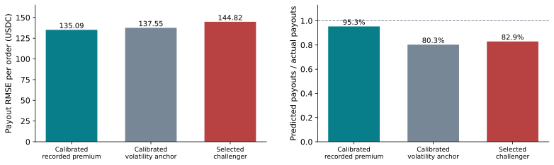
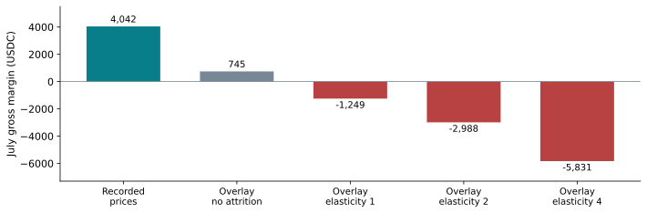
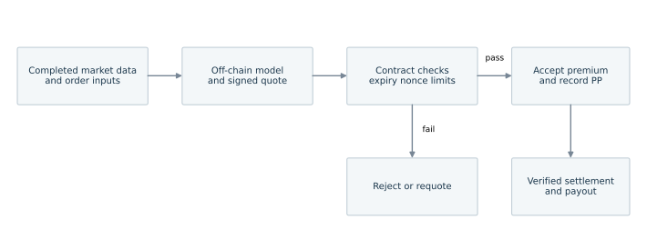

# Jasper Vault PP pricing findings and submission plan

We propose an interpretable payout model with a bounded pricing adjustment and an explicit validation gate. The first challenger improved the June development score but **underperformed in July**, so the delivered configuration preserves the recorded reference premium. The contribution is a reproducible model, a clear economic test and a disciplined decision about when an adjustment should be activated. We cannot yet claim a better premium or higher sustainable profit.

This document explains how the assignment was approached, the model and findings, what the team can submit, and the next experiments. All reported numerical results use the **original EN release**. The repository also contains an enriched API-base release; its implications are addressed separately below. The [README](../README.md) contains executable reproduction commands and [methodology.md](methodology.md) contains the complete specification.

## Assignment interpretation and research approach

The assignment's Option 2 asks for stable, sustainable positive returns within controlled risk limits while keeping protection attractive to users. It permits either a multiplier on an existing base price or an independent pricing model. Simply raising all prices does not answer the commercial problem. Required deliverables are a PowerPoint deck, a ten-minute video, code and any supporting materials, due 18 October 2026 at 11:59 p.m. via Canvas. The team should confirm Canvas's displayed timezone.

PP protects a perpetual position for a short contractual period; it is not an expiry-free option. The supplied class notes describe ATM contracts, zero deductible, full coverage, seven durations from 0.5 to 24 hours, and early closing. This study therefore does not claim to estimate OTM or moneyness effects. We preserve the dictionary's `0 = Call` and `1 = Put` payoff directions without converting the notes' shorthand into an unverified protected-position label.

The work combined two delegated research streams with a central synthesis:

1. **Dataset and dictionary research:** inspect source definitions, chronology, exclusions, market joins, available pricing inputs and economic accounting; build and test a reproducible baseline and candidate family.
2. **Online research:** review primary research and official product/oracle documentation for plausible PP improvements, then distinguish established methods, proposed extensions and claims that the supplied data can actually test.
3. **Model synthesis:** use an option-shaped cost anchor, empirical payout calibration, a bounded adjustment and temporal validation; evaluate both prediction and commercial scenarios.
4. **Verification and reporting:** test outcome independence, future-data exclusion, invalid-input handling, model serialization and numerical reproduction; prepare evidence and a presentation narrative.

The sources are the [assignment brief](../../../../../materials/briefs/Blockchain%20Group%20Assignment.pdf), [Jasper case statement](../../../../../materials/case-study/Jasper%20Vault%20Options%20Pricing%20Optimisation.docx), [supplied class notes](classnotes.md), and the original [dictionary](../../../../../data/en/data_dictionary.csv), [guide](../../../../../data/en/research_dataset_guide.md) and [metadata](../../../../../data/en/pp_research_datasets_metadata.json). External research references appear at the end.

## Data findings and interpretation

Per the class notes, `realizedProfit_USDC` is interpreted as Jasper's gross payout to its customer. Gross margin is therefore recorded premium minus payout, before other costs. `premiumAmount_USDC` is a paid premium in the EN file, not a separately observed internal API base quote. The target is expected payout among historically purchased orders and their early-close behavior. It is not a risk-neutral fair value or an estimate of price-demand causality.

| Audit item | Original EN finding |
| --- | ---: |
| Supplied orders | 7,831 |
| One-minute BTCUSDC perpetual candles | 338,917 |
| Missing payout and close | 64 |
| Close precedes creation | 86 |
| Expiration precedes creation | 67 |
| Nominal-duration discrepancy above 120 seconds | 181 |
| Excluded union / retained labelled analysis rows | 228 / 7,603 |
| Zero payouts in retained sample | 56.1% |
| Closes more than 60 seconds before expiry | 64.1% |
| Retained premiums / payouts | 247,715.49 / 231,820.12 USDC |
| Retained gross margin before other costs | 15,895.37 USDC |

Exclusion flags overlap. Counts must not be added. Quote validity is separate from outcome validity: an unknown blind payout never invalidates an otherwise valid quote. In the input-schema demonstration, 7,650 rows have valid quote features, 114 have explicit timing fallbacks, and 67 impossible-expiry rows have no quote.

Early closes are common enough that a terminal European payoff is an inadequate unverified description of PP settlement. They motivate learning observed payout costs and requesting the actual close, refund, exercise and settlement rules before constructing a more structural model. They do not establish that PP has American exercise rights.

## Proposed pricing model

Let `N = quantity_BTC × strikePrice`, and let `H = productType / 60` be minutes of advertised protection. Compute one-minute log returns using only fully closed candles. Let `v60` and `v1440` be trailing means of squared returns over 60 and 1,440 minutes, and set `v = 0.5v60 + 0.5v1440`.

The zero-carry ATM option-shaped anchor is:

```text
A = N × [2 Φ(sqrt(H × v) / 2) − 1]
```

It provides a financially interpretable scale. The fixed equal-weight variance blend is a benchmark assumption, not a fitted HAR-RV forecast or observed implied volatility. We fit a positive correction to this anchor:

```text
Expected payout = A × exp(beta0 + beta1 z1 + ... + beta4 z4)
```

The four features are log duration, Put indicator, clipped fast/slow log-volatility ratio and clipped signed 60-minute momentum. Means and scales are estimated on training observations only. The model minimizes notional-weighted quasi-Poisson loss on payout basis points with a ridge penalty on slopes. This loss accommodates zero and noninteger monetary outcomes without assuming literal Poisson-distributed dollar payouts.

For the experimental premium adjustment, let `B` be the recorded premium and `kappa` the fit-sample payout/premium ratio:

```text
M = clip(c × sqrt(max(expected_payout / (kappa × B), 0.000001)), 0.85, 1.15)
Recommended premium = B × [1 + w × (M − 1)]
```

`c` makes total experimental premiums equal total recorded premiums on the fit sample. It is frozen for the holdout. The square root and ±15% bounds are commercial design assumptions, not Jasper's undisclosed conversion constraint. They do not ensure future revenue neutrality. The July experimental fit uses `kappa = 0.9170461006` and `c = 1.0668864483`.

**Current decision: `w = 0`.** `deployment_model.json` retains the reference quote and exposes the challenger separately. The frozen July evaluation artifact has `w = 1` so the failed experiment remains reproducible. The guard avoids adopting the tested harmful adjustment; it does not itself demonstrate better pricing than Jasper.

For example, with `B = 20 USDC` and expected payout `25 USDC`, the frozen experimental multiplier reaches the 1.15 cap and proposes 23 USDC. The current gated recommendation remains 20 USDC. This is an arithmetic illustration, not an observed trade.

## Chronological evaluation and results

Features use only candles with close timestamps at or before the quote time, with maximum candle age 60 seconds. The main quote-time proxy is `createdAt`; a sensitivity uses the earlier of creation and expiry minus advertised duration. Settlement time controls when a label may enter training. Payouts, actual holding time and future returns are never quote predictors.

| Sample | Eligible orders | Use |
| --- | ---: | --- |
| February–May, labels settled before 1 June | 2,650 | Initial fitting |
| June, labels settled before 1 July | 2,322 | Candidate selection |
| All eligible labels settled before 1 July | 4,975 | Refit selected specification |
| July through the supplied training endpoint | 2,625 | Internal holdout |
| Labels available before 31 July 17:11:48 UTC | 7,585 | Separate deployment-artifact refit |

Fourteen candidates compare recorded-premium and option-shaped anchors, with scalar, duration/side or full-state corrections. Nonscalar ridge strengths are 0.1, 1 and 10. June weighted quasi-Poisson deviance selects `anchor_bps_state_ridge0.1`; selection is not revised after inspecting July. The July holdout is an internal test, not the missing August partner-blind validation. Eighteen otherwise eligible labels were unavailable at the later deployment cutoff and are excluded from that refit.

| July cost model | MAE USDC | RMSE USDC | Predicted / actual payouts | Weighted deviance |
| --- | ---: | ---: | ---: | ---: |
| Calibrated recorded-premium reference | 44.81 | 135.09 | 95.35% | 66.70 |
| Calibrated option-shaped anchor | 43.50 | 137.55 | 80.26% | 71.17 |
| June-selected state challenger | 46.34 | 144.82 | 82.91% | 79.15 |



The challenger improved June deviance from 72.36 to 68.39, but its July payout forecast was only 84,399.14 USDC against 101,796.82 realized. The calibrated recorded-premium model predicted 97,059.11. The selected challenger particularly underpredicted Call payouts and overpredicted Put payouts in July; this shows instability without identifying its cause.

A paired UTC-day bootstrap with 2,000 resamples and seed 271828 gives a 95% interval of **+2.78 to +16.21 USDC** for challenger RMSE minus calibrated-reference RMSE. It accounts for within-day grouping, conditional on the fitted models and 31 observed days. It does not capture all cross-day dependence, model-selection uncertainty or future regime risk. The conservative quote-clock sensitivity gives the same conclusion: 144.84 versus 135.09 USDC RMSE.

Lower MAE for a different model is not sufficient evidence of better expected-cost pricing: with many zero payouts, aggregate underprediction may still look favorable on absolute error. July has now been inspected and cannot provide a fresh test of a revised candidate.

## Commercial meaning and risk limits

At unchanged fills and payoffs, the experimental adjustment lowers July premiums by 3.12% and reduces gross margin from **4,042.04 to 744.84 USDC**. Assumed retention weights `min(1, M^(-elasticity))` thin historical purchasers after price increases; discounts do not invent new customers.

| Assumed elasticity | Retained orders | Experimental gross margin USDC |
| --- | ---: | ---: |
| 0 | 100.0% | 744.84 |
| 1 | 96.5% | −1,248.60 |
| 2 | 93.3% | −2,988.22 |
| 4 | 88.1% | −5,831.08 |



These are sensitivity scenarios, not estimated demand, causal profit changes or forecasts. The data lacks rejected quotes and customers who did not buy. All numbers exclude fees, funding, hedge P&L, capital and operating costs. Holding every trade and payout fixed, a revenue-neutral redistribution of premiums cannot increase aggregate margin. A meaningful improvement must change acceptance, exposure, costs or hedging, or improve a properly specified commercial objective.

There are nine negative July **order-creation-date cohorts**, with worst gross margin −5,056.73 USDC. Allocating eventual payouts to opening date does not measure daily settlement cashflow, mark-to-market drawdown or open-book risk. Scaling every payout by 1.25 produces −21,407.17 USDC at recorded premiums; this is a deterministic stress with no assigned probability. Vault capital and inventory are needed for solvency or risk-adjusted return claims.

## Next study using the base-premium release

The repository contains additional evidence not used in the original EN experiment. Its [enriched guide](../../../../../data/with_base_premium/research_dataset_guide.md) describes a 7,204-order training population after removing 627 negative-markup rows. It adds per-BTC order premium, API base quote and residual markup. The metadata records 1,131 unmatched base quotes. Quotes are matched by side and tenor to the nearest timestamp within 120 seconds after timezone alignment, but individual matched timestamps are absent from the packaged data.

The guide describes these fields as observable at creation. A nearest-time match can nevertheless select a later quote, so individual quote timestamps are needed to verify past-only availability independently. The recorded residual may contain PP conversion, moneyness, subsidies or execution effects; it is not necessarily Jasper's configured markup. This does not override the original notes' ATM assignment scope.

The next experiment should:

1. Audit row alignment and filtering against EN, report both the full original population and an aligned matched population, and avoid treating excluded negative-markup rows as random missingness.
2. Verify the quote timestamp and PP/base conversion semantics. Multiplying `apiBasePrice_per_BTC_USDC` by BTC quantity gives an order-sized **API quote amount**, which should not be called a PP premium until the product mapping is confirmed.
3. Define missing/stale-base handling explicitly. Do not silently substitute paid premiums for unmatched API quotes or label a mixed reference as one baseline.
4. Refit a calibrated API-base cost benchmark and a pooled/shrunk challenger on the same eligible rows and chronological cutoffs. The current code ignores the enrichment columns and therefore does not implement this experiment by changing the input path alone.
5. Freeze the specification and commercial acceptance rule before seeing new outcomes. Request Jasper's conversion/scoring formula, blind orders and sufficient market coverage; compare candidate and true-base performance on that fresh evaluation.

No enriched-release performance numbers or improved-base-pricing claims are made in this PR.

## Research directions and blockchain implementation

| Direction | Why it matters for PP | Required evidence before a claim |
| --- | --- | --- |
| Early-close and payout probability/severity models | Frequent early closing can dominate realized cost | Contract rules; past-only features; future-period calibration |
| Multihorizon variance and jump/event features | Short protection windows can be exposed to volatility shocks | Timestamped inputs; compare against the simple blend; fresh tests |
| Shrunk or time-varying direction effects | July shows fragility in fitted Call/Put differences | Multiple chronological windows and adequate sample sizes |
| Quote freshness and oracle confidence | A cost estimate can fail if executed on stale inputs | Quote/oracle timestamps, confidence rules and execution logs |
| Portfolio inventory and capital charges | Many simultaneous BTC claims share exposure | Complete open positions, hedges, capital and portfolio loss tests |
| Causal demand measurement | Accepted orders alone cannot reveal conversion | Logged rejected quotes or a designed pricing experiment |

Corsi motivates multihorizon volatility modeling; Barndorff-Nielsen and Shephard motivate separating continuous variation and jumps. Longstaff–Schwartz becomes relevant only if genuine American exercise rights and a defensible continuation model apply. Historical Lyra designs motivate inventory-aware option pricing, while Pyth's documentation motivates stale-price and confidence checks. These are established ideas to test in the PP context, not novel theories or proven improvements in this dataset.

A proposed blockchain design keeps cost estimation off-chain and issues a signed, expiring quote. An on-chain contract verifies signature, nonce, quote expiry and exposure limits before accepting the premium, then uses a verified settlement source for payout. Stale inputs or failed checks trigger rejection/requoting. This is a proposed architecture; smart-contract code and an audit are outside the implemented package, and this diagram is not a claim about Jasper's current implementation.



## What the assignment submission will contain

The submission narrative should be: **“We built and tested an interpretable payout model and a controlled pricing process. The first adjustment failed a future-period test, so we retain the reference premium and define the evidence required to activate an improved model.”** Whether this satisfies the partner's expected final performance requires their actual scoring and blind validation. Do not relabel the guarded reference as a newly superior premium.

| Deliverable | Contents | Current status |
| --- | --- | --- |
| Code | Analysis/train/predict CLI, validation checks, pinned dependencies, figure generator | Included and reproducible |
| Findings document | Scope, model, evidence, limitations, enriched-release next steps | This document and the detailed methodology |
| Supporting evidence | Aggregate metrics, model JSONs, audit, bootstrap, figures | Committed compact results; detailed rows regenerate locally |
| PowerPoint | Main narrative below; appendices for coefficients, exclusions and assumptions | Ready to construct from the evidence |
| Ten-minute video | Team explanation aligned with the deck | Still to record |
| Blind prediction file | One supported recommendation/status per supplied observation in original row order | Waiting for the validation file and adequate market data |
| Partner comparison | Actual base, conversion/cost score, held-out outcomes and activation decision | Still required before an improvement claim |

The proposed ten-slide speaking plan totals exactly ten minutes:

| Slide | Time | Main message / evidence |
| --- | --- | --- |
| 1. Commercial objective | 0:40 | Stable returns, controlled risk and attractive premiums |
| 2. PP product and scope | 0:50 | Short-dated ATM protection and payout interpretation |
| 3. Data audit | 1:00 | 7,603 retained orders; early closing; monthly loss ratios |
| 4. Model and worked quote | 1:15 | Option-shaped anchor, corrections, bounded adjustment and gate |
| 5. Validation | 1:00 | Past-only data, label availability, June selection and July holdout |
| 6. July results | 1:10 | RMSE, calibration and the failed challenger |
| 7. Commercial scenarios | 1:10 | Margin reduction, buyer retention assumptions and missing costs |
| 8. Deployment decision | 1:00 | Weight zero now; predeclared fresh-test activation criteria |
| 9. Blockchain and next research | 1:00 | Quote controls, enriched API-base audit and settlement behavior |
| 10. Recommendation and remaining work | 0:55 | Reproducible evidence, blind test and responsible conclusion |

Use `figures/monthly_loss_ratio.svg`, `holdout_comparison.svg`, `commercial_scenarios.svg` and `deployment_architecture.svg`. The figure builder also creates PNG versions. Put detailed coefficients, input flags, timing sensitivity and elasticity assumptions in backup slides. Keep the forecast benchmark and commercial benchmark clearly labelled.

Before final submission, resolve flagged/no-quote rows with Jasper, obtain complete blind inputs, agree the acceptance rule and cost accounting, and reconcile deck numbers with the frozen evidence. Revised models need a separately labelled evaluation. The code package and findings are ready for review; the deck, video and blind scoring are not yet completed.

## Primary research references

The original online research reviewed these sources on 12 October 2026. The references support modeling directions and product context, not the empirical performance claims, which come from the provided data and code.

1. [Jasper Vault — Perpetuals Protect documentation](https://docs.jaspervault.io/product/jasper-vault-perpetuals-protect).
2. [Black and Scholes (1973) — The Pricing of Options and Corporate Liabilities](https://www.sfu.ca/~kkasa/BlackScholes_73.pdf), Journal of Political Economy 81(3), 637–654.
3. [Corsi (2009) — A Simple Approximate Long-Memory Model of Realized Volatility](https://doi.org/10.1093/jjfinec/nbp001), Journal of Financial Econometrics 7(2), 174–196.
4. [Barndorff-Nielsen and Shephard (2004) — Power and Bipower Variation with Stochastic Volatility and Jumps](https://doi.org/10.1093/jjfinec/nbh001), Journal of Financial Econometrics 2(1), 1–37.
5. [Longstaff and Schwartz (2001) — Valuing American Options by Simulation](https://escholarship.org/uc/item/43n1k4jb), Review of Financial Studies 14(1), 113–147.
6. [Lyra (2021) — Introducing Lyra](https://insights.derive.xyz/introducing_lyra/), historical protocol design.
7. [Pyth — Price-feed best practices](https://docs.pyth.network/price-feeds/core/best-practices), oracle execution guidance.
