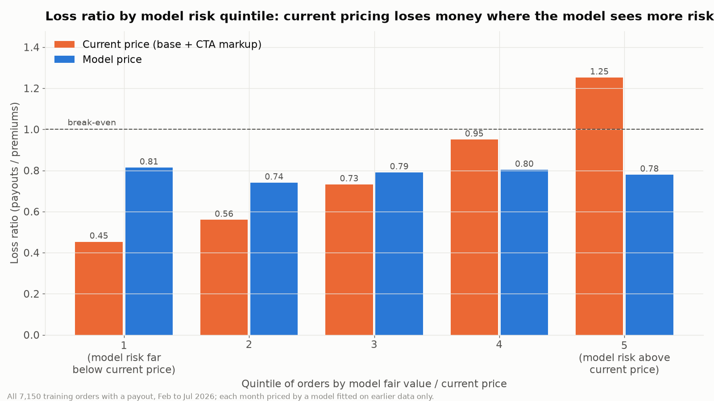
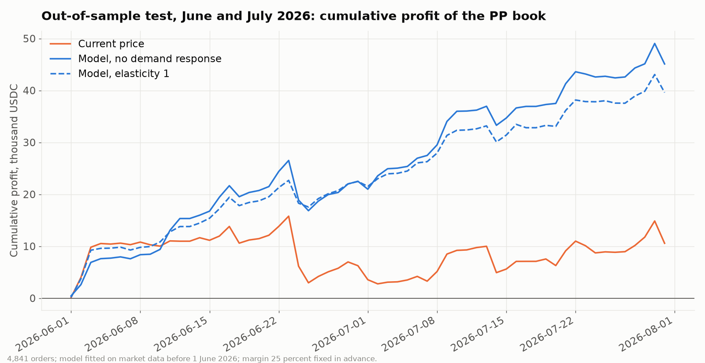

# Perpetual Protect pricing strategy (Maksim)

Pricing strategy for Jasper Vault's Perpetual Protect (PP): analysis, code, backtests and a recommended premium for every order in the validation file. This folder is a working strategy for the team, not a final submission document.

**Recommended rule.** `premium = quantity x fair value per BTC x 1.25`, never below Jasper Vault's API base price when that quote exists. The fair value is half the expected size of the BTC move over the protection window, forecast from recent volatility, the time of day (US Eastern) and scheduled US releases (CPI, jobs report, FOMC). The model is fitted on BTC market data only; no order outcome is used to fit it. **Proposed risk policy:** cap open protected notional at 250,000 USDC per direction and hedge the book's net delta within 0.5 BTC.

All profit figures are **gross underwriting profit**: premiums minus payouts. Operating costs, hedging capital and required risk capital are not included unless stated.

## Summary

| Question | Answer and evidence |
| --- | --- |
| How profitable is current pricing? | Barely. February to July 2026: premiums 248,089 USDC, payouts 230,652 USDC, gross profit 17,437, loss ratio 0.93. |
| Does today's markup over the base price follow risk? | No reliable relation in this sample. The effective markup (today's price minus the API base price, which includes the CTA layer and other effects) has an ordered Lorenz Gini of 0.01 against the base price (90 percent interval minus 0.05 to 0.07). |
| Does the model follow risk? | Yes, in training. On the 3,947 June and July test orders with a base quote, Gini 0.175 against the current price (0.10 to 0.24) and 0.151 against the base price (0.10 to 0.20). Payouts were 0.98 of fair value over February to July (0.88 to 1.10). |
| Which factors matter? | Recent volatility and above all the time of day: BTC variance in the half hour after the 09:30 ET US equity open is about 3.8 times its weekly average, and the base price ignores this. Scheduled releases add extra variance (estimate unstable, 0 to 57 basis points). No reliable effect of direction or of order size above 1,000 USDC was found in this sample. |
| Profit on training data (June and July test) | 45,101 against 10,576 for current pricing with no demand response (difference 34,525, day-level 90 percent interval 23,142 to 45,646). If price rises lose orders with elasticity 1 and price cuts win none: 36,485 (difference 25,910, interval 13,194 to 39,219). If every order priced above today is lost: 12,280, not reliably different from current pricing (interval minus 21,260 to 28,112). |
| Better pricing or just higher pricing? | Mostly higher. Total premium is 16.5 percent above today's. Against a flat raise of every current price to the same total, the profit difference is not statistically significant under smooth or conservative demand. Under the conservative rule the model keeps more orders (90.5 against 85.8 percent) and has smaller losses on bad days (worst day minus 4,257 against minus 7,322). |
| Validation period (the file given to us) | Checked once after the recommendations were frozen (commit c70c413). All 4,155 orders: premium 205,824 USDC, payouts 201,003, gross profit 4,821, loss ratio 0.98; August lost money while BTC rose 25 percent, September and October were profitable. On orders with a base quote the model lost less than the base price and a flat markup on it; on the 544 orders with a recorded price it did slightly worse than actual pricing. See section 6. |
| Risk | The proposed policy cuts the worst training day from minus 8,399 to minus 3,976 USDC and daily volatility by 33 percent, at a cost of 30 percent of gross profit and 15 percent of premium volume. Losses concentrate in strongly trending months such as August 2026. See section 7. |
| Margin | A business decision, not an optimum: under conservative demand a 25 percent margin keeps about 84 percent of today's premium and 90 percent of orders over February to July; 20 percent keeps 85 percent, 30 percent keeps 82 percent. See section 5.4. |



## Contents

1. [The product and the data](#1-the-product-and-the-data)
2. [What the data shows](#2-what-the-data-shows)
3. [The model](#3-the-model)
4. [How the model was tested](#4-how-the-model-was-tested)
5. [Results on training data](#5-results-on-training-data)
6. [Results on the validation period](#6-results-on-the-validation-period)
7. [Risk policy](#7-risk-policy)
8. [Validation recommendations](#8-validation-recommendations)
9. [Data integrity notes](#9-data-integrity-notes)
10. [Limitations and open decisions](#10-limitations-and-open-decisions)
11. [How to reproduce](#11-how-to-reproduce)
12. [Appendix A. Model variants and features tested](#appendix-a-model-variants-and-features-tested)
13. [Appendix B. Overfitting checks](#appendix-b-overfitting-checks)

## 1. The product and the data

PP is short-dated protection on a perpetual futures position. A trader who is long buys a put (option type 1), a trader who is short buys a call (option type 0). All products in the data are at the money with zero deductible and last 0.5, 1, 2, 4, 8, 12 or 24 hours. The user pays the premium up front; Jasper Vault pays out if the price moves against the position.

**How the payout is computed.** The payout equals `quantity x max(price at close minus strike, 0)` for a call and `quantity x max(strike minus price at close, 0)` for a put, where "close" is when the user closes the protection (67 percent of orders close more than 30 seconds before expiry) or the expiry time. Checked against the one-minute BTC candles (price at a timestamp = close of the minute that contains it): the formula gives 231,193 USDC in total against 230,652 recorded (0.2 percent apart), per-BTC correlation 0.994; among the 46 percent of orders that paid out the median difference is 16.7 USDC per BTC (8 percent).

**Files used.**

| File | Content |
| --- | --- |
| `../data/with_base_premium/pp_transactions_training.csv` | 7,204 orders, 2 February to 31 July 2026, with the API base price per BTC (blank for 1,131 orders) |
| `data/pp_transactions_validation.csv` | 4,155 orders, 31 July to 14 October 2026, outcome hidden |
| `data/btc_market_history_2026-01-01_to_2026-10-14.parquet` | 412,080 one-minute BTCUSDC perpetual candles; identical to the supplied file on every overlapping candle except the last, which was still open when the supplied file was cut |
| `data/macro_events_2026.csv` | 38 US releases (CPI, jobs report, FOMC, PCE), January to October 2026, with official source URLs, checked by a second independent pass |
| `data/nyse_holidays_2026.csv` | NYSE full-day closures in 2026 from nyse.com (used only in Appendix A) |

## 2. What the data shows

Numbers come from `run_descriptive.py` (`results/descriptive_facts.json`) unless stated otherwise.

1. **Current pricing is close to break-even.** Loss ratio 0.93 overall; above 1 in some segments (4-hour products 1.14 over February to July; 08:00 to 12:00 UTC 1.23 in June and July).
2. **The API base price is too low.** Payouts were 1.40 times the base price in total. The base is a Black-Scholes value whose implied volatility fell from about 50 percent per year in February and March to about 31 percent in July. For 30-minute and 1-hour orders it is below the realised volatility of the hour before the order (medians 36 and 33 against 44 and 41 percent); for longer products the two are similar. The main shortfall is that the base does not change with the time of day, while orders cluster in the most volatile hours.
3. **The effective markup does not follow risk.** Split into five equal groups by markup over base, the lowest group (mean 1.15 times base) lost money (loss ratio 1.18) and the highest (mean 2.50 times base) was very profitable (0.56), while payouts per unit of base price were similar in all groups (1.30 to 1.47). The dataset guide calls this markup an effective residual: it contains the CTA layer but may also contain subsidies and execution effects.
4. **Time of day is the largest missing factor.** On weekdays BTC variance in the half hour after 09:30 ET is 3.8 times its average over all minutes of the week (final profile in `outputs/model_card.json`) and stays above average until early afternoon; nights and weekends are calmer.
5. **Scheduled releases move BTC.** In the 30 minutes after a release BTC moved 2.6 times as much as in the same clock window on preceding release-free weekdays for FOMC decisions (5 releases), 1.8 times for the jobs report (7), 1.4 times for CPI (7) and 0.92 times for PCE (8), so PCE is not used. The counts are small.
6. **Early closing does not raise payouts.** With the same price convention, payouts at the actual close were 0.85 to 1.01 of what holding to expiry would have paid in every product length, both directions and every size tier, so forecasting the full-window move errs on the safe side.
7. **No reliable direction effect.** BTC was at 77,626 at the first training order and 62,798 at the last, and puts lost more than calls, but relative to fair value calls paid 0.90 and puts 1.10 with both 90 percent intervals including 1. A six-month trend is not a forecast for the next hours, so the model prices the size of the move, not its direction.

## 3. The model

```
premium (USDC) = quantity (BTC) x fair value per BTC x (1 + margin), with margin = 25 percent
                 and premium per BTC >= API base price per BTC whenever a base quote exists

fair value per BTC = Black-Scholes value with window volatility s = expected |move| x sqrt(pi / 2)
                   = strike x expected |move| / 2 for an at-the-money option
```

1. **Expected move.** For each product length, a Poisson regression (log link) predicts the expected absolute log return over the window from the volatility of the last hour, 4 hours, day and week, and the typical activity of the window and of the last hour from the US Eastern time-of-day profile. It is fitted on market history (one window every 5 minutes: about 41,000 windows per length in the June development fit and 59,000 in the final fit), not on orders.
2. **Scheduled releases.** A CPI, jobs report or FOMC release inside the window adds a fixed variance, estimated from past releases (57 basis points of move in the final fit, from 19 releases). Leaving release windows out of the regression changes fair values by 0.3 percent (Appendix B), so double counting is negligible.
3. **Fair value.** The expected move is converted into a window volatility and priced with Black-Scholes at zero interest. For other strikes (for example a deductible) the same formula applies, which is how moneyness enters.
4. **Margin and floor.** 25 percent margin (a target loss ratio of 80 percent), set as a business target before any test at that margin. The floor at the API base price is a conservative commercial choice, not a proven necessity: it never quotes below Jasper Vault's own reference price, applied to 16 percent of June and July test orders with a base quote; whether prices below base would win enough extra business is unknown.

**Worked example.** 16 June 2026, 13:39 UTC (09:39 ET, nine minutes after the US equity open), 1-hour put, 0.1702 BTC, strike 65,994 USDC. The last hour was active (about 58 percent per year) and the window is the busiest hour of the day (time-of-day factor 3.5). Expected move 0.66 percent, fair value 217.85 per BTC, model premium 0.1702 x 272.31 = **46.35 USDC**, against a base price of 15.76 and a current price of **28.23 USDC**. Actual payout: 84.07 USDC. Both prices lost money on this order (current price 55.83, model 37.72); the point is the average over thousands of orders.

## 4. How the model was tested

- **Training data.** Development fit before 1 June 2026, test on the 4,841 June and July orders; and a walk-forward test in which every month from February to July is priced by a model fitted on earlier data only. June and July were also used to compare variants during development (Appendix B), so they are not fully untouched.
- **Validation period.** The validation file given to us, checked once after the recommendations were frozen and pushed (section 6).
- **Ranking test.** Ordered Lorenz curve and Gini index (Frees, Meyers and Cummings, 2011): does a premium charge more where payouts turn out larger, independent of the price level. Intervals resample whole days.
- **Conversion rules.** The case's conversion constraint is not published, so profit is shown under several rules for an order priced at P instead of today's price A: no demand response; elasticity e with weight `(P / A) ^ (-e)` (capped at 3), which lets price cuts win extra orders; a **conservative rule** in which rises lose orders with elasticity e and cuts win none; and strict thresholds (an order is kept only if P is at most A, or at most 1.25 A). Under elasticity 1 or less any uniform price rise raises profit, so only the conservative and threshold rules separate better pricing from higher pricing.
- **Benchmarks.** Current pricing; the API base price; a flat markup on the base (1.37, the average before June); flat raises of every current price by 16.5 percent (the model's total) and by 25 percent.
- **Uncertainty.** Profit differences carry a paired day-level 90 percent interval (`results/incremental_profit_intervals.csv`).
- 54 training orders have no close time and no payout and are excluded.

## 5. Results on training data

### 5.1 June and July 2026 test (4,841 orders, gross profit in USDC)

| Conversion rule | Current price | Model | Flat raise x1.165 (same total as model) | Flat raise x1.25 |
| --- | ---: | ---: | ---: | ---: |
| No demand response | 10,576 | 45,101 | 45,101 | 62,925 |
| Elasticity 1 | 10,576 | 39,603 | 38,717 | 50,340 |
| Conservative, elasticity 1 | 10,576 | 36,485 | 38,717 | 50,340 |
| Conservative, elasticity 2 | 10,576 | 30,713 | 33,237 | 40,272 |
| Keep only orders priced at or below today | 10,576 | 12,280 | 0 | 0 |
| Keep only orders at most 25 percent above today | 10,576 | 18,463 | 45,101 | 62,925 |

| Conservative rule, elasticity 1 | Current price | Model | Flat raise x1.165 |
| --- | ---: | ---: | ---: |
| Orders kept | 100 percent | 90.5 percent | 85.8 percent |
| Today's premium kept | 100 percent | 84.4 percent | 85.8 percent |
| Worst day (USDC) | minus 9,630 | minus 4,257 | minus 7,322 |
| Maximum drawdown (USDC) | 13,031 | 4,799 | 9,286 |

Model minus current pricing (day-level 90 percent intervals): no demand response 34,525 (23,142 to 45,646); elasticity 1 29,028 (17,386 to 41,409); conservative 25,910 (13,194 to 39,219); strict threshold 1,705 (minus 21,260 to 28,112). Model minus the equal-total flat raise: elasticity 1 886 (minus 7,449 to 9,259); conservative minus 2,232 (minus 11,434 to 7,197). The model's gain over current pricing is clear except under the strict threshold; its advantage over an equally large flat raise is in retention and risk, not in profit.

On the 3,947 test orders with a base quote, the API base price alone would have lost 53,246 and a flat 1.37 markup on the base 10,317; current pricing made 8 and the model 30,732.



### 5.2 Walk-forward, February to July 2026 (gross profit in USDC)

| Conversion rule | Current price | Model | Months the model earns more |
| --- | ---: | ---: | ---: |
| No demand response | 17,437 | 62,879 | 6 of 6 |
| Elasticity 1 | 17,437 | 53,864 | 6 of 6 |
| Conservative, elasticity 1 | 17,437 | 49,790 | |
| Keep only orders at most 25 percent above today | 17,437 | 28,911 | 4 of 6 |
| Keep only orders priced at or below today | 17,437 | 15,401 | 3 of 6 |

Under the strictest rule the model earns less in April (1,033 against 2,645), May (2,490 against 4,620) and July (3,715 against 4,319). In April and May current pricing was profitable (loss ratios 0.76 and 0.82); there the model's price cuts give margin away and its price rises lose orders that would have been profitable. This is the main commercial risk if the conversion constraint works this way.

### 5.3 Where the price changes

61 percent of orders get cheaper (median 0.89 times today's price), but orders holding 63 percent of today's premium get dearer: large orders plus 17 percent, medium plus 11 percent, small minus 6 percent.

| Segment (June and July) | Current loss ratio | Model loss ratio | Model price change |
| --- | ---: | ---: | ---: |
| 0.5-hour products | 0.62 | 0.70 | minus 13 percent |
| 4-hour products | 1.18 | 0.85 | plus 39 percent |
| 8-hour products | 1.01 | 0.78 | plus 29 percent |
| Orders 00:00 to 04:00 UTC | 0.73 | 0.90 | minus 19 percent |
| Orders 08:00 to 12:00 UTC | 1.23 | 0.92 | plus 34 percent |
| Release in window | 1.53 | 1.22 | plus 25 percent |

Payout / fair value by segment over February to July with 90 percent intervals (`results/payout_over_fair_value_walk_forward.csv`): 0.5 hours 0.91 (0.77 to 1.07), 1 hour 1.11 (0.95 to 1.29), 2 hours 0.98 (0.81 to 1.15), 4 hours 1.00 (0.83 to 1.17), 8 hours 0.95 (0.78 to 1.15), 12 hours 1.06 (0.83 to 1.40), **24 hours 0.45 (0.22 to 0.80)**, release in window 1.32 (0.83 to 1.94). Only 24-hour products are reliably mispriced (overpriced); the release-window excess is not distinguishable from noise with 283 orders.

### 5.4 Margin

The data give a trade-off, not a single margin (`results/margin_sensitivity_walk_forward.csv`, February to July walk-forward, gross profit in USDC):

| Margin | No demand response | Conservative, elasticity 1 | Orders kept | Today's premium kept | Keep if not dearer |
| --- | ---: | ---: | ---: | ---: | ---: |
| 10 percent | 28,758 | 25,213 | 93 percent | 89 percent | 12,071 |
| 20 percent | 51,383 | 41,974 | 91 percent | 85 percent | 13,544 |
| 25 percent (chosen) | 62,879 | 49,790 | 90 percent | 84 percent | 15,401 |
| 30 percent | 74,434 | 57,198 | 88 percent | 82 percent | 16,104 |
| 40 percent | 97,665 | 70,794 | 86 percent | 78 percent | 15,471 |
| Current price | 17,437 | 17,437 | 100 percent | 100 percent | 17,437 |

**Selection rule:** management sets the minimum share of today's premium it is willing to keep; the margin is the most profitable value that keeps at least that share under conservative demand. At 85 percent this gives 20 percent; at 80 percent it gives 30 percent; 25 percent sits between. Under the strict threshold no margin beats current pricing over the six months. A small randomised price test would measure the real elasticity.

## 6. Results on the validation period

The validation file hides payouts, but they can be recomputed from `closedAt` and BTC prices (on training orders this reconstruction is within 0.23 percent of the recorded total). With the team's agreement this was done once, by `run_sealed_check.py`, after the recommendations were frozen and pushed (commit c70c413, 14 October 2026, 18:15 SGT; the script refuses to run on any other version of the file). The model was not changed afterwards. Outputs: `results/sealed_check/`.

| All 4,155 validation orders | Gross profit in USDC |
| --- | ---: |
| Model premium | 205,824 |
| Payouts | 201,003 |
| Gross profit | 4,821 |
| Loss ratio | 0.98 |

- **Benchmarks** on the 1,960 orders with a base quote (no demand response): model minus 20,006 (loss ratio 1.34), a flat 1.44 markup on the base price (today's average markup) minus 25,844 (1.48), the base price alone minus 42,310 (2.14). The model's Gini against the base price is minus 0.085, so its ranking advantage from training did not hold in this period.
- **Against actual prices.** On the 544 orders where the actual price can be recovered (base plus recorded markup), actual pricing lost 26,119 and the model 27,684.
- **By month.** August minus 12,667 (BTC rose 25 percent, so protection for short positions paid out far more than its fair value), September plus 10,812, October to the 14th plus 6,679.
- **Settlement convention.** With other reasonable price conventions for the close, total profit is 8,444 instead of 4,821.

Conclusion: over the validation period the model was slightly profitable, lost less than the base-derived benchmarks, and did not show a reliable advantage over actual pricing where that is known.

## 7. Risk policy

Tested in `run_extensions.py` on the February to July walk-forward (model prices) and, post hoc, on the validation period (frozen prices). All rows use the same cash-flow dates: premium on the opening day, payout on the closing day, trading fees (0.04 percent per side) on the day they are paid; per-order hedge profit is booked when the protection closes and net-book hedge profit as it accrues. Both hedges enter at the close of the last minute before the order and exit at the payout price, and the net-book hedge is flattened whenever the book is empty. The hedge is an **opening-delta hedge**: each protection's delta is fixed at opening (Black-Scholes with the model's window volatility) and not updated as the price moves. Outputs: `results/extensions/hedging_summary.csv`, `exposure_limits.csv`.

| Training, February to July | Gross profit after fees | Orders rejected | Premium rejected | Worst day | Maximum drawdown | Standard deviation of daily profit |
| --- | ---: | ---: | ---: | ---: | ---: | ---: |
| No controls | 62,879 | 0 | 0 | minus 8,399 | 10,688 | 1,271 |
| Hedge every order separately | 31,276 | 0 | 0 | minus 5,830 | 9,635 | 1,033 |
| Net-book hedge within 0.5 BTC | 49,717 | 0 | 0 | minus 5,208 | 8,115 | 1,032 |
| Cap 250,000 USDC per direction | 55,753 | 3.6 percent | 14.6 percent | minus 6,594 | 9,326 | 1,003 |
| **Policy: cap 250,000 plus net hedge within 0.5 BTC** | **44,194** | **3.6 percent** | **14.6 percent** | **minus 3,976** | **7,815** | **854** |

- **Policy.** Pause new sales in a direction while its open protected notional would exceed 250,000 USDC (with an illustrative 5 percent adverse move, a stress loss of 12,500 USDC per direction), and hedge the net delta of the accepted book whenever it drifts more than 0.5 BTC. On training data this cuts the worst day by 53 percent, daily volatility by 33 percent and the maximum drawdown by 27 percent, for 30 percent of gross profit. Caps of 400,000 and 150,000 USDC are in the output file (the first barely binds; the second rejects a third of premium).
- **Validation period, post hoc:** the policy improves the worst day from minus 16,083 to minus 15,137 and the maximum drawdown from 35,451 to 27,712, but turns the 4,821 profit into minus 1,879; hedging every order separately costs more than it saves. These controls limit, but do not prevent, losses in a month like August.
- The risk appetite (cap size, hedge band) is Jasper Vault's decision; the table shows the trade-off.

## 8. Validation recommendations

`outputs/validation_recommendations.csv` keeps the 13 original columns unchanged (same text, row order and CRLF line endings) and adds `recommended_premium_USDC` (the recommendation for every row), `recommended_price_per_BTC_USDC`, `recommended_multiplier_vs_base` (informational; blank when the base is blank), `fair_value_per_BTC_USDC`, `expected_abs_move_bps`, `macro_release_in_window` and `floor_at_base_applied`. The model was fitted on candles up to 31 July 2026, 17:11:12 UTC, and frozen (SHA-256 in `outputs/FROZEN.json`, parameters in `outputs/model_card.json`).

All 4,155 rows have a premium (205,824 USDC in total); 1,960 have a base quote, of which 704 are at the floor; the multiplier against the base price has a 5th, 50th and 95th percentile of 1.00, 1.18 and 2.18. Over all 1,960 rows with a base quote the premium-weighted multiplier is 1.60, against 1.44 for today's actual prices over the training period.

## 9. Data integrity notes

- **The validation file reveals its own outcomes.** `closedAt` is still filled in (the guide says it would be blank) and the BTC history supplied with the validation file runs to 14 October 2026 (the earlier archive version ended on 24 August), so hidden payouts can be recomputed. The pricing code drops `closedAt` and uses only candles that closed before each order (`tests/test_no_lookahead.py`: altering every later price, range or volume leaves the premiums of 150 validation orders exactly unchanged, while altering the hour before them changes them). Jasper Vault may want to know about this.
- **Quote time.** Features use the last candle closed before `createdAt`, as the guide prescribes; the implied contract start is a median 18 seconds earlier, and re-pricing at that start changes total premium by 0.05 percent. The API base quote was matched within 120 seconds of the order and is treated as available at the order, as the guide states.
- 54 training orders without close time or payout are excluded; 1,131 training and 2,195 validation orders have no base price (the model does not need it).
- Times are UTC; the time-of-day profile uses US Eastern time, including the daylight saving change on 8 March 2026. Validation timestamps in two formats are both parsed; minute-only timestamps are truncated, so the last closed candle is always before the order.

## 10. Limitations and open decisions

- **Validation result.** Only slightly profitable over the validation period (loss ratio 0.98), with a loss in August, and the model's ranking advantage over the base price did not hold there (section 6).
- **Conversion rule.** Unknown; the model clearly beats current pricing under smooth and conservative demand but not under the strict threshold rule (sections 5.1 and 5.2).
- **Margin and risk appetite** are business decisions (sections 5.4 and 7).
- **Trend and volatility shocks.** Losses concentrate in strongly trending or volatile months; exposure caps and hedging limit but do not prevent them.
- **Segments.** 24-hour products are overpriced by the model (payout / fair value 0.45); release windows look underpriced but the evidence is weak.
- Profit is gross underwriting profit; operating costs and risk capital are not modelled.

## 11. How to reproduce

```bash
cd maksim
python3 -m venv .venv && .venv/bin/pip install -r requirements.txt
.venv/bin/python run_descriptive.py          # results/descriptive_facts.json
.venv/bin/python run_backtest.py             # results/*.csv
.venv/bin/python run_overfitting_checks.py   # results/overfitting/*.csv
.venv/bin/python run_validation.py           # outputs/validation_recommendations.csv (frozen; must match FROZEN.json)
.venv/bin/python run_extensions.py           # results/extensions/* (risk policy, candidate features)
.venv/bin/python make_figures.py             # results/figures/*.png
.venv/bin/python -m pytest tests -q          # no-look-ahead test
```

| Path | Content |
| --- | --- |
| `src/` | data loading, market features, model, pricer, evaluation |
| `run_descriptive.py` | facts in section 2 |
| `run_backtest.py` | training tests, benchmarks, margin frontier, intervals, segments |
| `run_overfitting_checks.py` | Appendix B |
| `run_validation.py` | final fit and validation recommendations |
| `run_sealed_check.py` | one-time holdout check of the frozen file (section 6) |
| `run_extensions.py` | risk policy (section 7) and candidate features (Appendix A) |
| `tests/test_no_lookahead.py` | prices depend only on data before the order |

## Appendix A. Model variants and features tested

| Model variant (June and July test) | Forecast error (Poisson deviance) | Gini against current price | Gini against base price |
| --- | ---: | ---: | ---: |
| Average move only | 54.07 | 0.065 | minus 0.025 |
| Recent volatility | 50.35 | 0.061 | 0.010 |
| plus time of day | 47.67 | 0.164 | 0.136 |
| plus scheduled releases (final) | 47.51 | 0.175 | 0.151 |
| plus HMM regime | 47.99 | 0.175 | 0.150 |

- **Hidden Markov regimes** (two states on hourly variance, forward filter only): no improvement in forecast or ranking.
- **News sentiment (NLP):** no timestamped news archive was supplied; the release calendar captures the predictable part of news risk without look-ahead.
- **Range-based volatility and trading activity** (Parkinson high-low variance, relative volume, taker imbalance) and **US market holidays**: tested after the holdout check under a rule committed beforehand (commit f8801e8: out-of-sample skill gain of at least 0.005 in at least 5 of 7 product lengths and a walk-forward Gini not lower). Neither passed (0 and 1 of 7 lengths); the holiday calendar raised walk-forward profit to 65,105 and is a reasonable production change, but it is not in the submitted prices (`results/extensions/decision.json`).
- **Size tiers:** unstable over time (large orders paid out 0.84 of fair value in February to May and 1.01 in June and July); only orders under 1,000 USDC pay out less (0.79), and they hold about 1 percent of premium.
- **Charging by direction:** calls 0.90 and puts 1.10 of fair value; both intervals include 1.
- **Blending with the base price:** once the model is known the base adds no reliable ranking information in this sample (Gini minus 0.004, interval minus 0.05 to 0.05); it is used only as a floor.

## Appendix B. Overfitting checks

Outputs in `results/overfitting/` (`run_overfitting_checks.py`).

- **Parameters.** 7 regressions with 7 coefficients each, a 96-value time-of-day profile and one release parameter, all fitted on market data; no parameter is fitted on order payouts.
- **In sample against out of sample.** Refitted at five monthly cut-offs and scored on the following month: skill (reduction in forecast error against an average-move model) 0.208 in sample and 0.187 out of sample; out-of-sample forecasts slightly too high on average (realised / predicted 0.955).
- **Stability.** The last-hour volatility coefficient varies by 0.01 to 0.03 across six fits; the weekday time-of-day profile fitted on January to March correlates 0.93 with the one fitted on April to July (weekend 0.55); the release effect is the least stable parameter (0 to 57 basis points).
- **Agreement with theory.** The volatility coefficients should add up to about 0.5 (the expected move scales with the square root of variance); averaged over the six fits they add up to 0.50 for 30-minute windows and 0.43 to 0.48 for the other lengths, without this being imposed.
- **Release double counting.** Refitting with release windows excluded changes fair values by minus 0.26 percent overall (minus 0.41 percent in release windows) and leaves the Gini at 0.188 (`release_double_counting.csv`).
- **Design decisions by sub-period** (walk-forward, gross profit, `design_variants_by_period.csv`):

| Variant | Feb to May, no demand response | Feb to May, keep if not dearer | Jun and Jul, no demand response | Jun and Jul, keep if not dearer |
| --- | ---: | ---: | ---: | ---: |
| Current price | 6,861 | 6,861 | 10,576 | 10,576 |
| Recent volatility only | 5,500 | minus 313 | minus 2,671 | minus 7,104 |
| Simplest: recent volatility and time of day | 13,354 | 3,131 | 46,525 | 8,642 |
| plus releases | 13,679 | 3,231 | 48,654 | 11,623 |
| plus floor (final model) | 13,859 | 3,412 | 49,020 | 11,990 |
| with PCE as a release type | 13,871 | 3,428 | 48,775 | 11,224 |
| plus size tiers | 16,013 | 1,788 | 29,681 | 10,212 |

The simplest version already earns 95 percent of the final model's profit over February to July; later choices each add little and point the same way in both sub-periods.

**Decision log.**

| Decision | Made after seeing | Re-checked on |
| --- | --- | --- |
| Price the size of the move, not its direction | training data | training data only |
| Add time of day | loss ratio by hour, February to July orders | February to May (table) |
| Releases as extra variance; leave out PCE | event study, January to July prices | February to May (table) |
| Drop size tiers | June and July test | February to May (table) |
| Floor at the base price | June and July test, walk-forward | February to May (table) |
| Margin 25 percent | set before any test at that margin | margin frontier (section 5.4) |
| Range, volume and holiday features (not adopted) | after the holdout check; rule committed first (f8801e8) | training data only |
| Risk policy (no price change) | after an external review | training data; validation post hoc |

Reference: Frees, E. W., Meyers, G. and Cummings, A. D. (2011). Summarizing insurance scores using a Gini index. Journal of the American Statistical Association, 106(495), 1085 to 1098. https://doi.org/10.1198/jasa.2011.tm10506
